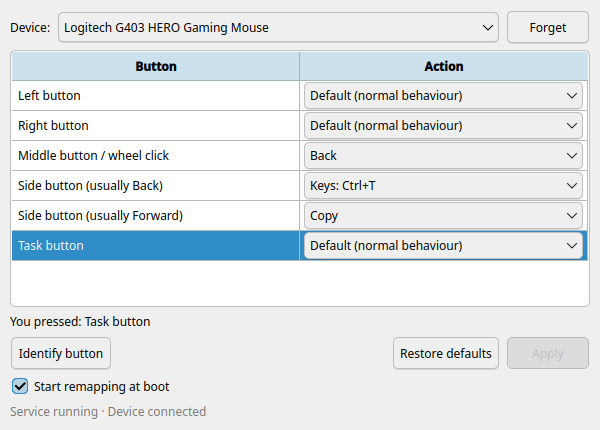
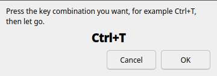
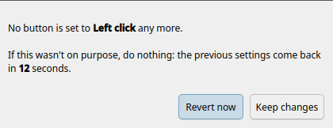

# BallKey

A simple button remapper for any mouse or trackball on Linux.

Install one package, open BallKey once, choose what each button does,
click **Apply**, and you're done. Your settings apply automatically at
every boot and whenever the device is reconnected.



- Works with **any brand** of mouse or trackball.
- Works on **Wayland and X11**, on any desktop (KDE, GNOME, …).
- **No terminal needed**: everything happens in the app; changes ask for
  your password in the normal system prompt.
- **Can't lock you out**: if a change leaves no button doing a left
  click, BallKey asks you to confirm and puts the old settings back after
  15 seconds otherwise.

## About this project

BallKey was vibecoded, and it's my first project. I don't know how to
program: I described what I wanted, an AI coding assistant (Claude Code)
wrote the code, and I tested each step on my own computer (Fedora KDE,
with a Logitech G403 mouse) before moving on. The Debian, Ubuntu and
Arch packages have only been tested in containers, not on real hardware.

It works well for me, but no experienced Linux developer has reviewed it
yet, so please keep that in mind. Bug reports and code review are very
welcome.

## Install

Download the package for your distribution, then:

| Distribution | Package | Install |
|---|---|---|
| Fedora 44+ | `ballkey-…noarch.rpm` | Double-click it (opens Discover / Software), or `sudo dnf install ./ballkey-*.noarch.rpm` |
| Debian 13+, Ubuntu 26.04+ | `ballkey_…_all.deb` | `sudo apt install ./ballkey_*_all.deb` |
| Arch Linux | `ballkey-…-any.pkg.tar.zst` | `sudo pacman -U ballkey-*-any.pkg.tar.zst` |

Everything else BallKey needs is installed automatically from your
distribution's own repositories. Ubuntu 24.04 isn't supported (it has no
PySide6 package).

## Use

1. Open **BallKey** from your app menu.
2. Pick your mouse or trackball under **Device**.
3. Choose an action for each button. Not sure which button is which?
   Click **Identify button** and press it: its row is highlighted.
4. Click **Apply** and enter your password.

Actions: Left / Right / Middle click, Double-click, Back, Forward, Copy,
Paste, Undo, Do nothing, Default (normal behaviour), and **Custom key
combo…**, where you simply press the keys you want:



If no button is left doing a left click, you'll see this. Do nothing and
your previous settings come back:



**Start remapping at boot** (on by default): untick it if you don't want
your buttons changed after a restart. Opening BallKey turns remapping
back on for that session.

The list shows the common buttons; extra buttons appear when you use
**Identify button** on them. **Restore defaults** sets every button back
to normal (click **Apply** to save).

**Forget** (next to the device list) removes the device BallKey has set
up, together with its button settings. Use it for a mouse you no longer
have; it shows as "(not connected)" in the list.

## Uninstall

Remove the `ballkey` package (Discover/Software, `sudo dnf remove ballkey`,
`sudo apt purge ballkey`, or `sudo pacman -R ballkey`). Your mouse goes
back to normal immediately. On Debian/Ubuntu, `apt remove` keeps your
settings and `apt purge` deletes them.

## Troubleshooting

- **Status says "Service not running":** `systemctl status ballkey` shows
  what's wrong; the full log is in `journalctl -u ballkey`.
- **A button acts strangely:** stopping the service always returns the
  device to normal: `sudo systemctl stop ballkey`.
- **Device not found:** check that the mouse works at all, then try
  another USB port, or reconnect it over Bluetooth.

Settings are stored in `/etc/ballkey/config.json`.

## How it works

A small background service (Python, `python-evdev`) takes exclusive
control of the chosen device and passes everything through a virtual
device, replacing only the buttons you mapped. It runs as root under
systemd and talks to the app over the system D-Bus; saving settings is
protected by polkit. If the service stops or crashes, the kernel hands
the device straight back, so it always falls back to working normally.

| Part | File |
|---|---|
| Background service | `daemon/ballkeyd.py` |
| Settings app (PySide6) | `gui/ballkey-settings.py` |
| systemd, D-Bus, polkit, launcher files | `packaging/` |
| Package recipe (nfpm) | `nfpm.yaml` |

## Build and test

```
./scripts/build-packages.sh     # .rpm, .deb and Arch packages into dist/
./tests/container-test.sh       # install/run/remove in Fedora, Debian, Ubuntu and Arch containers (podman)
```

`build-packages.sh` downloads a pinned, checksum-verified copy of
[nfpm](https://nfpm.goreleaser.com/) into `build/` the first time.

For development, `sudo ./scripts/dev-install.sh` installs straight from
the source folder (undo with `sudo ./scripts/dev-uninstall.sh`), and
`tools/ballkey-ctl.py` is a command-line client for the service's D-Bus
API.

## License

GPL-3.0-or-later. See [LICENSE](LICENSE).
