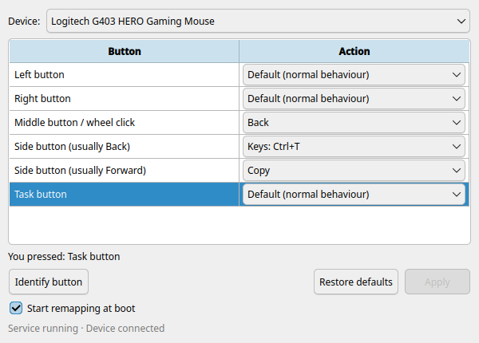
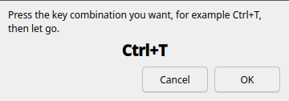
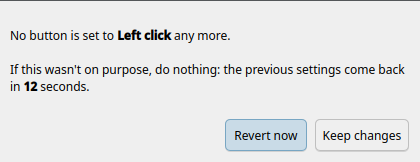

# BallKey

A simple button remapper for any mouse or trackball on Linux.

Install one package, open BallKey once, choose what each button does,
click **Apply**, and you're done. Your settings apply automatically at
every boot and whenever the device is reconnected.



- Works with **any brand** of mouse or trackball.
- Works on **Wayland and X11**, on any desktop (KDE, GNOME, …).
- **No terminal needed**: everything happens in the app; changes ask for
  your password in the normal system prompt.
- **Can't lock you out**: if a change leaves no button doing a left
  click, BallKey asks you to confirm and puts the old settings back after
  15 seconds otherwise.

## About this project

BallKey was vibecoded, and it's my first project. I don't know how to
program: I described what I wanted, an AI coding assistant (Claude Code)
wrote the code, and I tested each step on my own computer (Fedora KDE,
with a Logitech G502 HERO, Logitech G403 and Kensington Expert) before
moving on. The Debian-based and Arch packages have only been tested in
containers, not on real hardware.

It works well for me, but no experienced Linux developer has reviewed it
yet, so please keep that in mind. Bug reports and code review are very
welcome.

## Install

### From the terminal

BallKey isn't in Fedora's or Debian's own repositories, so these commands
first add BallKey's update repository, then install from it. New versions
then arrive with your normal system updates.

**Fedora 43+:**

```
sudo dnf copr enable gino8807/ballkey
sudo dnf install ballkey
```

**Debian 13+ and Debian-based:**

```
sudo wget -qO /usr/share/keyrings/ballkey-archive-keyring.asc https://raw.githubusercontent.com/gino8807/ballkey/main/packaging/ballkey-archive-keyring.asc
sudo wget -qO /etc/apt/sources.list.d/ballkey.sources https://raw.githubusercontent.com/gino8807/ballkey/main/packaging/ballkey-apt.sources
sudo apt update
sudo apt install ballkey
```

The first two lines download BallKey's signing key and repository
address, the same files the package installs itself.

### From a downloaded package

Download the package for your distribution, then:

| Distribution | Package | Install |
|---|---|---|
| Fedora 43+ | `ballkey-…fc44.noarch.rpm` | Double-click it (opens Discover / Software), or `sudo dnf install ./ballkey-*.noarch.rpm` |
| Debian 13+ and Debian-based | `ballkey_…_all.deb` | `sudo apt install ./ballkey_*_all.deb` |
| Arch Linux | `ballkey-…-any.pkg.tar.zst` | `sudo pacman -U ballkey-*-any.pkg.tar.zst` |

**Updates:**

- **Fedora:** the package adds BallKey's update repository
  ([COPR](https://copr.fedorainfracloud.org/coprs/gino8807/ballkey/)),
  so Discover / Software and `dnf upgrade` find new versions by themselves.
- **Debian-based:** from 0.1.6 on, the package adds BallKey's signed
  update repository (on GitHub Pages), so Discover / Software and
  `sudo apt update && sudo apt upgrade` find new versions by themselves.
  If you have 0.1.5 or older, install 0.1.6 by hand once.
- **Arch:** automatic updates for Arch aren't available yet. They'll
  come through the AUR, but AUR account registration is currently down,
  so I can't publish BallKey there yet. It's in my plans. For now,
  download and install new versions by hand.

**Older versions** (back to 0.1.0) are on the
[Releases page](https://github.com/gino8807/ballkey/releases), in case
you need one.

Everything else BallKey needs is installed automatically from your
distribution's own repositories. Ubuntu 24.04 isn't supported (it has no
PySide6 package).

## Use

1. Open **BallKey** from your app menu.
2. Pick your mouse or trackball under **Device**.
3. Choose an action for each button. Not sure which button is which?
   Click **Identify button** and press it: its row is highlighted.
4. Click **Apply** and enter your password.

Actions:

- **Clicks:** Left / Right / Middle click, Double left / right / middle
  click, and Left / Right / Middle **drag**: press once to hold the
  button down, move, then press again (or click normally) to let go.
- **Browsing:** Back, Forward.
- **Editing:** Undo, Redo, Cut, Copy, Paste, Select all, Find.
- **Media:** Play / pause, Stop, Next track, Previous track, Volume up,
  Volume down, Microphone on/off.
- **Keyboard key or combo…:** simply press the key or keys you want.
  Keys you can't press (not on your keyboard, or caught by the desktop)
  can be picked from a list in the same window.
- Do nothing, and Default (normal behaviour).



If no button is left doing a left click, you'll see this. Do nothing and
your previous settings come back:



**Button combinations**: under the button list, click **Add
combination…**, tick two or more buttons, and choose what pressing them
*together* does. For example, on a mouse without a scroll wheel, set
**Left + Right** to **Middle click**. The buttons in a combination still
work on their own; they just react a few milliseconds later, while
BallKey waits to see whether you're pressing the other ones too.
Buttons that type keys (see below) can be in combinations too, with
mouse buttons or with each other, for example the G502's Ctrl+C and
Ctrl+V buttons together. Wheel tilt can't, since it's never held down.

**Start remapping at boot** (on by default): untick it if you don't want
your buttons changed after a restart. Opening BallKey turns remapping
back on for that session.

**Wheel tilt**: if your scroll wheel tilts left and right, **Wheel tilt
left** and **Wheel tilt right** appear in the list. Left on Default,
tilting scrolls sideways as usual.

**Buttons that type keys**: some gaming mice, like the Logitech G502,
have buttons that type a shortcut (for example Ctrl+C) instead of acting
as mouse buttons. On the G502 HERO, the two that type Ctrl+C and Ctrl+V
from the factory are already in the list. For any other one, click
**Identify button** and press it: it's added to the list, for example as
"Button that types Ctrl+C", and you can give it any action or use it in
a combination. Left on Default, it keeps typing its shortcut.

Linux can't tell which buttons type which keys until you press them, so
BallKey only knows the G502's factory shortcuts. If you changed them
with Piper, the list still shows Ctrl+C and Ctrl+V; identify the
buttons again to add what they type now.

If your mouse shows up in your system as part keyboard, like the G502
(it's listed as both a mouse and a keyboard), any button that isn't
in the list should appear after you click **Identify button** and press
it. If it doesn't (apart from the buttons the mouse handles by itself,
below), please
[open a bug report](https://github.com/gino8807/ballkey/issues) with
your mouse's name so I can fix it.

Buttons the mouse handles by itself, like the G502's DPI and sniper
buttons, send nothing to the computer, so BallKey can't change them. To
change DPI or reassign the DPI and sniper buttons, use
[Piper](https://github.com/libratbag/piper), which works alongside
BallKey.

The list shows the common buttons; extra buttons appear when you use
**Identify button** on them. BallKey remembers identified buttons for
each mouse, so you only identify each one once. **Restore defaults** sets every button back
to normal and removes all combinations (click **Apply** to save).

**Forget** (next to the device list) removes the device BallKey has set
up, together with its button settings and identified buttons. Use it for a mouse you no longer
have; it shows as "(not connected)" in the list.

## Uninstall

Remove the `ballkey` package (Discover/Software, `sudo dnf remove ballkey`,
`sudo apt purge ballkey`, or `sudo pacman -R ballkey`). Your mouse goes
back to normal immediately. On Debian-based distributions, `apt remove` keeps your
settings and `apt purge` deletes them.

## Troubleshooting

- **Status says "Service not running":** `systemctl status ballkey` shows
  what's wrong; the full log is in `journalctl -u ballkey`.
- **A button acts strangely:** stopping the service always returns the
  device to normal: `sudo systemctl stop ballkey`.
- **Device not found:** check that the mouse works at all, then try
  another USB port, or reconnect it over Bluetooth.

Settings are stored in `/etc/ballkey/config.json`.

## How it works

A small background service (Python, `python-evdev`) takes exclusive
control of the chosen device and passes everything through a virtual
device, replacing only the buttons you mapped. It runs as root under
systemd and talks to the app over the system D-Bus; saving settings is
protected by polkit. If the service stops or crashes, the kernel hands
the device straight back, so it always falls back to working normally.

| Part | File |
|---|---|
| Background service | `daemon/ballkeyd.py` |
| Settings app (PySide6) | `gui/ballkey-settings.py` |
| systemd, D-Bus, polkit, launcher files | `packaging/` |
| Package recipe (nfpm) | `nfpm.yaml` |

## Build and test

```
./scripts/build-packages.sh     # .rpm (in a Fedora container), .deb and Arch packages into dist/
./tests/container-test.sh       # install/run/remove in Fedora, Debian, Ubuntu and Arch containers (podman)
./tests/test-remap.py           # replay recorded mouse events through the remapping (no device needed)
```

`build-packages.sh` downloads a pinned, checksum-verified copy of
[nfpm](https://nfpm.goreleaser.com/) into `build/` the first time.

The `.rpm` is built from `packaging/ballkey.spec`; the `.deb` and Arch
packages from `nfpm.yaml`, which also holds the version number for all
three. `./scripts/copr-upload.sh` sends the source package to the COPR
update repository (needs a COPR API token in `~/.config/copr`; the owner
is set in `packaging/copr-owner`).
`./scripts/apt-publish.sh` adds the `.deb` to the Debian update
repository (the `apt/` folder of the `gh-pages` branch, served by GitHub
Pages), signed with the key from `./scripts/apt-make-key.sh`, which stays
in `~/.config/ballkey/apt-signing-key`. `./scripts/aur-publish.sh`
publishes `packaging/aur/PKGBUILD` to the AUR once the version's git tag
is on GitHub (needs your SSH key on your AUR account).

For development, `sudo ./scripts/dev-install.sh` installs straight from
the source folder (undo with `sudo ./scripts/dev-uninstall.sh`), and
`tools/ballkey-ctl.py` is a command-line client for the service's D-Bus
API.

## License

GPL-3.0-or-later. See [LICENSE](LICENSE).
